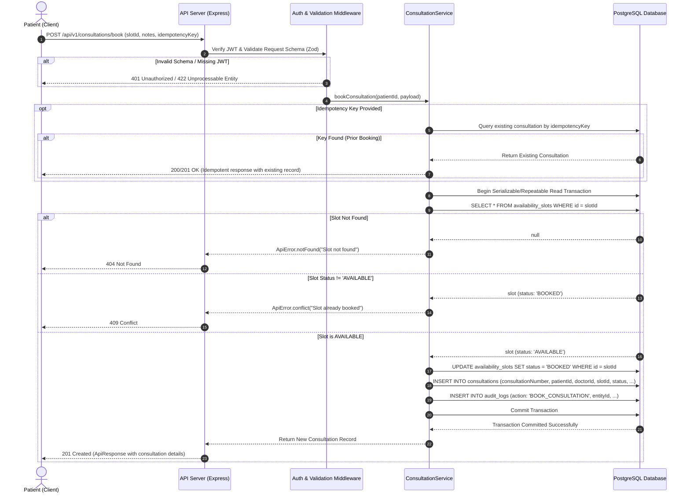

# Booking Sequence & Concurrency Handling

## 1. Overview

Appointment booking in a telemedicine platform is a high-contention operation where multiple patients may attempt to book the same doctor availability slot simultaneously.

The Amrutam booking engine combines:
1. **Idempotency Keys**: To protect against duplicate submissions resulting from network timeouts or retries.
2. **ACID Transactions (`prisma.$transaction`)**: To execute slot verification, slot state change, and appointment creation in a single atomic database operation.
3. **Database Constraints**: `slotId UNIQUE` on the `consultations` table guarantees at the database level that no two consultations can point to the same availability slot.

---

## 2. Booking Sequence Diagram



---

## 3. Concurrency Protection Deep Dive

### Concurrent Contention Scenario
Consider two patients, **Patient A** and **Patient B**, simultaneously submitting a booking request for Doctor X at 10:00 AM (`slotId: 42`).

```
Time | Patient A Request                       | Patient B Request
-----|-----------------------------------------|-----------------------------------------
T1   | Submits POST /consultations/book        | Submits POST /consultations/book
T2   | Opens DB Transaction TxA                | Opens DB Transaction TxB
T3   | SELECT slot 42 -> Status: AVAILABLE     | SELECT slot 42 -> Status: AVAILABLE
T4   | UPDATE slot 42 SET status = 'BOOKED'    | Waits or checks status
T5   | INSERT consultation (slotId: 42)        | Attempts INSERT consultation (slotId: 42)
T6   | TxA COMMITS successfully                | TxB encounters slotId UNIQUE constraint or slot status conflict
T7   | Receives 201 Created                    | Receives 409 Conflict ("Slot no longer available")
```

Even under high network concurrency:
- Only **one** transaction commits successfully.
- The losing transaction triggers either a status conflict check or violates the `slotId UNIQUE` constraint.
- The error handler intercepts the PostgreSQL unique violation (Prisma error code `P2002`) and transforms it into a clean, structured `409 Conflict` response with an explanatory message.
