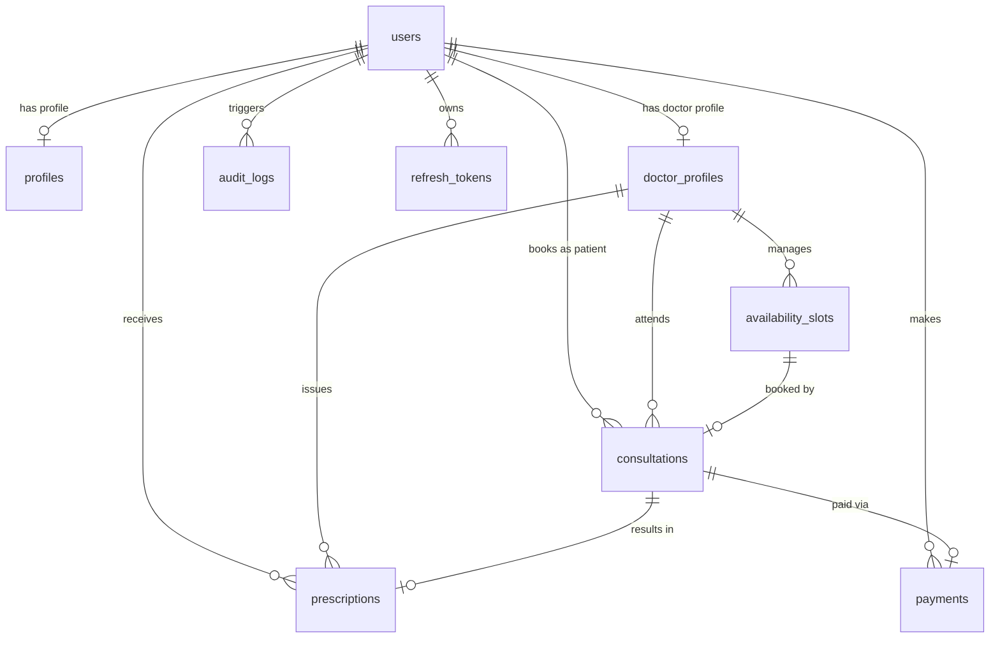

# Database Design & Data Architecture

## 1. Overview & Entity Relationship Model

The Amrutam Telemedicine database schema is implemented in PostgreSQL using Prisma ORM. It enforces strict referential integrity, constraints, indexes, and auditing.

---

## 2. Table Specifications & Schema Details

### 2.1 `users`
Core identity table supporting authentication and RBAC roles.
- `id` (UUID, PK): Unique user identifier.
- `email` (VARCHAR, UNIQUE): Unique email address, indexed for login lookups.
- `passwordHash` (TEXT): bcrypt-hashed password (salt rounds >= 10).
- `role` (ENUM: `PATIENT`, `DOCTOR`, `ADMIN`): System authorization role.
- `isActive` (BOOLEAN): Soft-disable flag for deactivating compromised or inactive accounts.
- `isMfaEnabled` (BOOLEAN): Flag for multi-factor authentication enablement.
- `mfaSecret` (TEXT, Nullable): Encrypted TOTP secret key.
- `createdAt`, `updatedAt` (TIMESTAMP WITH TIME ZONE).

### 2.2 `profiles`
Non-sensitive personal details for patients and platform users.
- `id` (UUID, PK).
- `userId` (UUID, UNIQUE, FK -> `users.id`, CASCADE).
- `firstName`, `lastName` (VARCHAR).
- `phone` (VARCHAR, Nullable).
- `dateOfBirth` (TIMESTAMP, Nullable).
- `gender` (ENUM: `MALE`, `FEMALE`, `OTHER`, `PREFER_NOT_TO_SAY`).
- `bloodGroup` (VARCHAR, Nullable).
- `address`, `emergencyContact` (TEXT, Nullable).

### 2.3 `doctor_profiles`
Professional credentials and consultation rates for certified doctors.
- `id` (UUID, PK).
- `userId` (UUID, UNIQUE, FK -> `users.id`, CASCADE).
- `licenseNumber` (VARCHAR, UNIQUE): Medical license identifier.
- `specialization` (VARCHAR): Indexed for doctor search queries.
- `experienceYears` (INTEGER): Years of clinical experience.
- `consultationFee` (DECIMAL(10,2)): Fee in INR.
- `qualification` (VARCHAR): Degree/certifications (e.g., BAMS, MD).
- `bio` (TEXT, Nullable).
- `isVerified` (BOOLEAN): Admin verification status. Indexed for public listing.

### 2.4 `availability_slots`
Doctor appointment availability slots.
- `id` (UUID, PK).
- `doctorId` (UUID, FK -> `doctor_profiles.id`, CASCADE).
- `startTime`, `endTime` (TIMESTAMP WITH TIME ZONE).
- `status` (ENUM: `AVAILABLE`, `BOOKED`, `BLOCKED`, `CANCELLED`).
- **Unique Constraint:** `[doctorId, startTime, endTime]` guarantees no overlapping identical slot generation.
- **Indexes:** `[doctorId, status]`, `[startTime, endTime]`.

### 2.5 `consultations`
Consultation appointments and lifecycle tracking.
- `id` (UUID, PK).
- `consultationNumber` (VARCHAR, UNIQUE): Human-readable reference (e.g., `AMR-172934000-A1B2`).
- `patientId` (UUID, FK -> `users.id`, RESTRICT).
- `doctorId` (UUID, FK -> `doctor_profiles.id`, RESTRICT).
- `slotId` (UUID, FK -> `availability_slots.id`, RESTRICT).
- **Partial Unique Index:** `consultations_active_slotId_key` enforces unique `slotId` WHERE `status != 'CANCELLED'`. Allows cancelled slots to be rebooked while preserving full historical consultation records.
- `status` (ENUM: `REQUESTED`, `SCHEDULED`, `IN_PROGRESS`, `COMPLETED`, `CANCELLED`, `NO_SHOW`).
- `scheduledAt` (TIMESTAMP WITH TIME ZONE).
- `startedAt`, `endedAt` (TIMESTAMP WITH TIME ZONE, Nullable).
- `notes` (TEXT, Nullable).
- `cancellationReason` (TEXT, Nullable).
- `idempotencyKey` (VARCHAR, UNIQUE, Nullable): Prevents duplicate booking creation on network retries.

### 2.6 `prescriptions`
Clinical prescriptions issued by doctors for completed/active consultations.
- `id` (UUID, PK).
- `consultationId` (UUID, UNIQUE, FK -> `consultations.id`, CASCADE).
- `doctorId` (UUID, FK -> `doctor_profiles.id`, RESTRICT).
- `patientId` (UUID, FK -> `users.id`, RESTRICT).
- `diagnosis` (TEXT).
- `medicines` (JSONB): Structured array of medicines, dosages, frequencies, and durations.
- `instructions` (TEXT, Nullable).
- `validUntil` (TIMESTAMP WITH TIME ZONE, Nullable).

### 2.7 `payments`
Financial transaction records linked to consultations.
- `id` (UUID, PK).
- `consultationId` (UUID, UNIQUE, FK -> `consultations.id`, CASCADE).
- `patientId` (UUID, FK -> `users.id`, RESTRICT).
- `amount` (DECIMAL(10,2)).
- `currency` (VARCHAR, default `'INR'`).
- `status` (ENUM: `PENDING`, `COMPLETED`, `FAILED`, `REFUNDED`).
- `paymentMethod` (VARCHAR, Nullable).
- `transactionRef` (VARCHAR, UNIQUE, Nullable): External gateway transaction identifier.

### 2.8 `audit_logs`
Compliance audit log capturing security-sensitive actions.
- `id` (UUID, PK).
- `userId` (UUID, FK -> `users.id`, SET NULL, Nullable).
- `action` (VARCHAR): e.g., `BOOK_CONSULTATION`, `CANCEL_CONSULTATION`, `UPDATE_ROLE`, `ISSUE_PRESCRIPTION`.
- `entityType` (VARCHAR): Name of affected model.
- `entityId` (VARCHAR, Nullable): ID of affected record.
- `ipAddress` (VARCHAR, Nullable).
- `userAgent` (VARCHAR, Nullable).
- `metadata` (JSONB, Nullable): Structured metadata (passwords and raw medical details explicitly excluded).
- `createdAt` (TIMESTAMP WITH TIME ZONE, default NOW). Indexed for chronological auditing.

### 2.9 `refresh_tokens`
Persisted session refresh tokens with rotation and revocation.
- `id` (UUID, PK).
- `userId` (UUID, FK -> `users.id`, CASCADE).
- `tokenHash` (VARCHAR, UNIQUE).
- `expiresAt` (TIMESTAMP WITH TIME ZONE).
- `revokedAt` (TIMESTAMP WITH TIME ZONE, Nullable).

### 2.10 `video_sessions`
Video consultation room descriptors and lifecycle status.
- `id` (UUID, PK).
- `consultationId` (UUID, UNIQUE, FK -> `consultations.id`, CASCADE).
- `roomId` (VARCHAR, UNIQUE): Secure hashed room identifier.
- `roomUrl` (VARCHAR): Provider room URL.
- `provider` (VARCHAR): `MOCK_WEBRTC` | `JITSI`.
- `status` (ENUM: `CREATED`, `ACTIVE`, `COMPLETED`, `TERMINATED`).
- `startedAt`, `endedAt` (TIMESTAMP WITH TIME ZONE, Nullable).

### 2.11 `consultation_messages`
Secure in-consultation clinical messages and medical attachments.
- `id` (UUID, PK).
- `consultationId` (UUID, FK -> `consultations.id`, CASCADE).
- `senderId` (UUID, FK -> `users.id`, RESTRICT).
- `messageType` (ENUM: `TEXT`, `ATTACHMENT`, `SYSTEM`).
- `content` (TEXT, Nullable).
- `attachmentKey` (VARCHAR, Nullable): Storage key in `STORAGE_DIR`.
- `attachmentName` (VARCHAR, Nullable): Sanitized file name.
- `mimeType` (VARCHAR, Nullable): Magic-byte validated MIME type.
- `sizeBytes` (INTEGER, Nullable).

### 2.12 `notifications`
PostgreSQL-backed durable asynchronous notification jobs.
- `id` (UUID, PK).
- `userId` (UUID, Nullable).
- `type` (ENUM: `BOOKING_CONFIRMED`, `CONSULTATION_CANCELLED`, `PRESCRIPTION_ISSUED`, `UPCOMING_REMINDER`, `PAYMENT_REFUNDED`, `SYSTEM`).
- `channel` (ENUM: `EMAIL`, `SMS`, `IN_APP`).
- `recipient` (VARCHAR, Nullable).
- `subject` (VARCHAR, Nullable).
- `content` (TEXT).
- `status` (ENUM: `PENDING`, `PROCESSING`, `SENT`, `FAILED`).
- `attempts`, `maxAttempts` (INTEGER).
- `nextRetryAt` (TIMESTAMP WITH TIME ZONE, Nullable).
- `idempotencyKey` (VARCHAR, UNIQUE, Nullable).

### 2.13 `refund_operations`
Durable payment refund state tracking with idempotency and partial-failure recovery.
- `id` (UUID, PK).
- `consultationId` (UUID, FK -> `consultations.id`, CASCADE).
- `paymentId` (UUID, FK -> `payments.id`, CASCADE).
- `amount` (DECIMAL(10,2)).
- `idempotencyKey` (VARCHAR, UNIQUE).
- `status` (VARCHAR): `PENDING` | `COMPLETED` | `FAILED`.
- `refundRef` (VARCHAR, Nullable).

---

## 3. High-Performance Indexing Strategy

1. **Trigram GIN Indexes (`pg_trgm`)**:
   - `doctor_profiles_specialization_trgm_idx` ON `doctor_profiles USING gin (specialization gin_trgm_ops)`
   - `doctor_profiles_qualification_trgm_idx` ON `doctor_profiles USING gin (qualification gin_trgm_ops)`
   - `doctor_profiles_bio_trgm_idx` ON `doctor_profiles USING gin (bio gin_trgm_ops)`
   - `profiles_firstName_trgm_idx` ON `profiles USING gin (firstName gin_trgm_ops)`
   - `profiles_lastName_trgm_idx` ON `profiles USING gin (lastName gin_trgm_ops)`
   *Replaces full-table scans with trigram index scans for wildcard `ILIKE '%term%'` doctor searches.*

2. **Partial Unique Index**:
   - `consultations_active_slotId_key` ON `consultations (slotId) WHERE status != 'CANCELLED'`.

